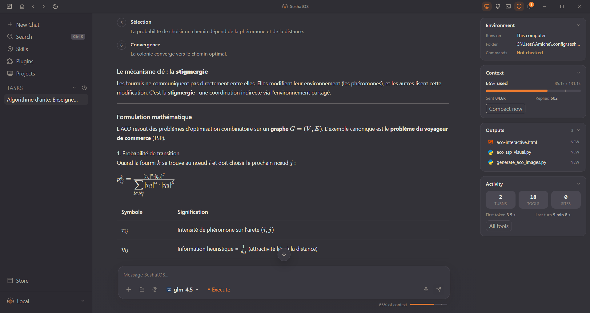
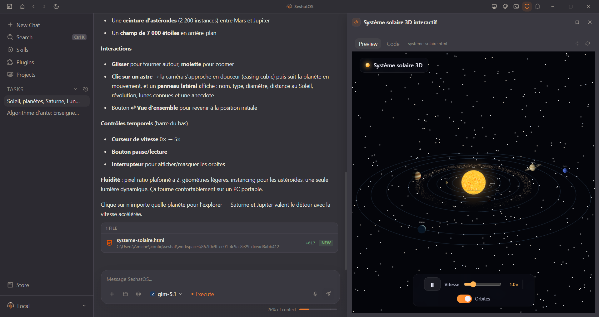
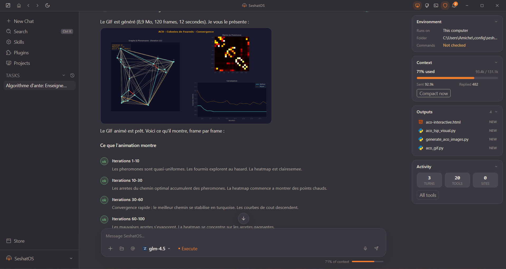
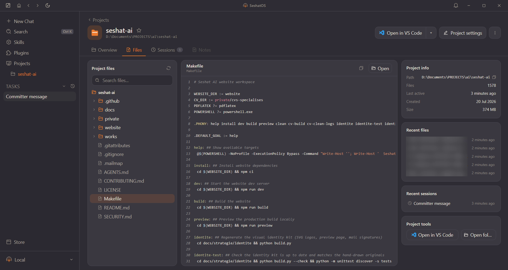
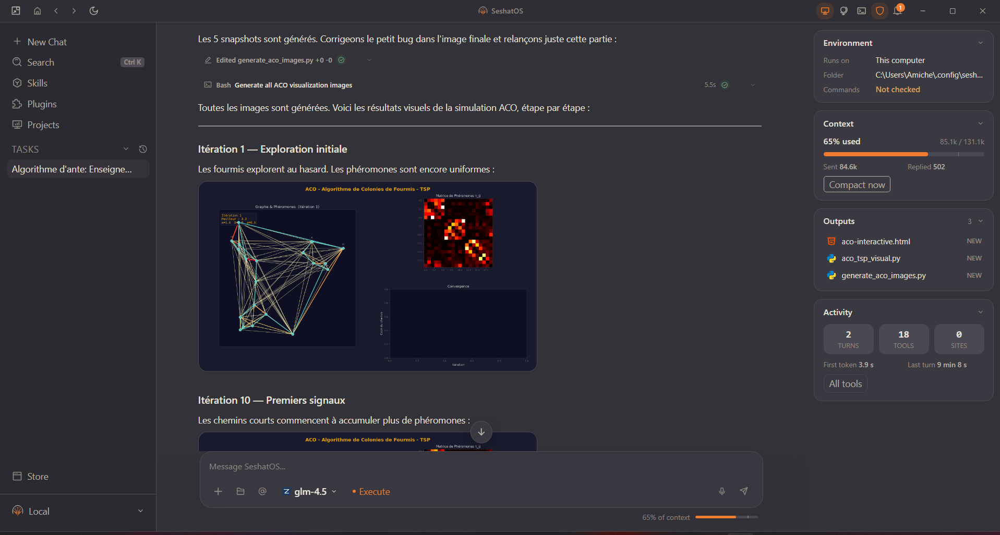
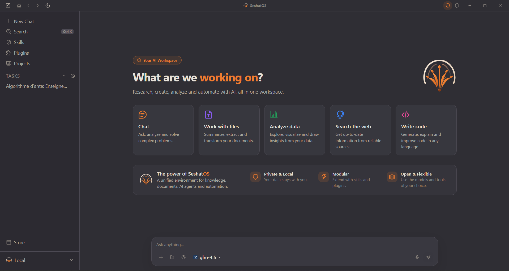

<p align="center">
  <picture>
    <source media="(prefers-color-scheme: dark)" srcset="docs/brand/lockup-on-dark.svg">
    
  </picture>
</p>

<h3 align="center">Your AI workspace, on your own computer.</h3>

<p align="center">
  An agent that researches, writes code, runs commands and builds what you ask for, right beside the conversation.<br>
  With the models of your choice, your own keys, and no account.
</p>

<p align="center">
  <a href="https://github.com/KPO-Tech/SeshatOS/releases/latest"><b>Download for Windows, Linux or macOS</b></a> ·
  <a href="https://seshat-ai.com/en"><b>Website</b></a> ·
  <a href="https://seshat-ai.com/en/docs"><b>Documentation</b></a> ·
  <a href="https://github.com/KPO-Tech/seshat-runtime/discussions"><b>Discussions</b></a>
</p>

<p align="center">
  <a href="https://github.com/KPO-Tech/SeshatOS/releases/latest"></a>
  
  <a href="#license"></a>
</p>

<!-- video: chat -->

## Answers you can read, not walls of text

Ask a question and the answer arrives with real tables, formulas, charts and architecture drawings, drawn by the app as they are written. Each one ends with the next steps you may want, one click away.

<p align="center"></p>

## It builds things, and shows them to you

Ask for a simulation, a dashboard or a 3D scene. The agent writes the page and it opens live beside the conversation, running in an isolated frame with no access to the app or the network.

Chart.js, three.js, React, D3, Tailwind, Mermaid, KaTeX and more ship with the app, so these pages also work offline. If a page breaks, the panel lists what went wrong and one click asks the agent to fix it.

<!-- video: 3d -->

<table>
  <tr>
    <td width="50%"></td>
    <td width="50%"></td>
  </tr>
  <tr>
    <td align="center"><sub>A 3D solar system you can explore, from one request</sub></td>
    <td align="center"><sub>Pictures, GIFs and clips it makes appear in the answer</sub></td>
  </tr>
</table>

## An agent that really works on your files

Open a project and the agent reads your code, edits it and runs your commands, asking first when it should. You follow every step, and the pull requests it opens are tracked until they can be merged.

<table>
  <tr>
    <td width="50%"></td>
    <td width="50%"></td>
  </tr>
  <tr>
    <td align="center"><sub>Your projects, their files and their sessions in one place</sub></td>
    <td align="center"><sub>Every step of the agent stays visible</sub></td>
  </tr>
</table>

## Everything in one workspace

<p align="center"></p>

- **Your models, your keys.** Pick the provider and the model you want, and change them from one conversation to the next.
- **Private by default.** The app and its data stay on your machine, with no account and no cloud. What you send goes only to the provider you chose.
- **Tools that extend it.** Skills, plugins and MCP servers, a web search, a built-in browser and a terminal.
- **Documents.** Attach your files and work from them, scanned pages included.
- **Yours to shape.** A dark and a light theme of your choice, switched in one click, or your own colours.

## Download

Installers are attached to each [release](https://github.com/KPO-Tech/SeshatOS/releases/latest):

| Platform | Installer |
|---|---|
| Windows (64-bit) | the `.exe` installer |
| Linux (64-bit) | the `.AppImage` (any distribution) or the `.deb` (Debian, Ubuntu) |
| macOS (Apple silicon or Intel) | the `.dmg` for your processor. **Experimental**: it has not been run on a Mac yet, and it has no built-in reader for scanned documents (the optional Indra reader in Config > Documents can read them) |

Every release also carries a `SHA256SUMS.txt` to check what you downloaded.

**The installers are not signed yet** (a certificate costs money and the project has none). The first time you open one:

- **Windows**: SmartScreen shows "Windows protected your PC". Choose **More info**, then **Run anyway**.
- **macOS**: right-click the app, choose **Open**, then confirm. The app does not update itself on macOS: download the new version from the release page.
- **Linux**: nothing to confirm; make the `.AppImage` executable first (`chmod +x`).

To build SeshatOS from source instead, see below.

## Status

SeshatOS is in active development, with a new version often. The installed app offers each update by itself, except on macOS for now.

| Capability | Status |
|---|---|
| Chat with tools, files, rich answers and live pages | Available |
| Projects, skills, plugins and MCP servers | Available |
| Local backend: sessions, memory, plans, audit | Available |
| Knowledge: search your documents and get cited answers | In development |

## Getting started

```bash
git clone <this-repo>
cd seshatos
cp .env.example .env   # fill in at least one provider API key
make setup              # first-time setup: Node deps + build
make dev                 # start the local backend + desktop app, keeping your data (FRESH=1 starts as a brand new install)
```

See [`docs/development.md`](./docs/development.md) for the full setup reference, and [`docs/architecture.md`](./docs/architecture.md) for how the pieces fit together.

To run the Seshat engine on its own, in a terminal and without the desktop app, follow its [installation guide](https://seshat-ai.com/en/docs/getting-started/installation) and the [quick start](https://seshat-ai.com/en/docs/getting-started/quick-start).

## How it is built

SeshatOS is the desktop product built on [seshat](https://github.com/KPO-Tech/seshat-runtime), the open-source Go agent runtime: an Electron desktop app (`seshat-desktop`) and a local Go backend (`seshat-backend`), the HTTP API the desktop talks to, which keeps the sessions and the memory.

## The Knowledge agent

Ask, in the Knowledge platform, is a chat conversation with a built-in agent that answers only from the documents the person can read, and cites them. It has two read-only tools (search and read), no shell, no web and no memory, and the collection limit is applied by the tools, not asked of the model. How it works, its tools and its current limits: [docs/knowledge-agent.md](docs/knowledge-agent.md).

<p align="center"></p>

## SeshatOS and SeshatCloud: two halves of one offer

| | SeshatOS (this repository) | [SeshatCloud](https://github.com/KPO-Tech/SeshatCloud) |
|---|---|---|
| Scope | One person or a small team, on their own machine | An organization, administered centrally |
| Runs | Locally, no account, no cloud required | Server + admin console, self-hosted via Docker Compose |
| Identity | Local | Organizations, roles, SCIM, audit |
| Automation | Not part of SeshatOS: scheduled work runs in SeshatCloud | Jobs, schedules, triggers and runs, independent of anyone's laptop |
| Knowledge | Local knowledge/RAG | Org-scoped knowledge at scale, document-intelligence service |

SeshatOS works on its own. SeshatCloud completes it when an organization needs shared administration and centrally governed automation. The connection is optional and one-directional (see below).

## Relationship to the Seshat engine and the commercial offering

- **[seshat](https://github.com/KPO-Tech/seshat-runtime)** is the underlying agent runtime (tools, providers, permissions, multi-agent) — a separate repository, plain Apache-2.0, that SeshatOS consumes as a Go module.
- **SeshatOS** (this repository) is the local, single-user/small-team product built on that runtime.
- **[SeshatCloud](https://github.com/KPO-Tech/SeshatCloud)** is the multi-tenant layer (organizations, team workspaces, admin controls, scheduled automation), a separate source-available codebase. `seshat-backend` can optionally connect to it ("connected mode") for identity/settings delegation, entirely over HTTP — none of its source is part of, or required by, this repository.
- The commercial activity around Seshat (AI consulting and integration) is presented at [seshat-ai.com](https://seshat-ai.com/en).
- The engine is documented at [seshat-ai.com/en/docs](https://seshat-ai.com/en/docs): the [concepts](https://seshat-ai.com/en/docs/concepts/what-is-seshat) (architecture, memory, security and trust, skills and MCP, retrieval), the [Go SDK](https://seshat-ai.com/en/docs/sdk/go-sdk) and the [HTTP API of SeshatOS](https://seshat-ai.com/en/docs/sdk/http-api).

## Vision

See [GOAL.md](./GOAL.md) for where the project is going, what's in scope, and what deliberately isn't.

## Contributing

See [CONTRIBUTING.md](./CONTRIBUTING.md) and [AGENTS.md](./AGENTS.md) (the latter is also what AI coding agents working in this repo should read first).

## License

Apache License 2.0, with the [Commons Clause](https://commonsclause.com/) condition: free to use, self-host, modify, and redistribute for any purpose — including internal use by organizations of any size — except selling it (offering it as a paid product or service to third parties). See [LICENSE](./LICENSE).

This makes SeshatOS **source-available**, not open source in the OSI sense. The underlying [seshat](https://github.com/KPO-Tech/seshat-runtime) runtime is plain Apache-2.0. The license is the unmodified standard Apache-2.0 text plus the unmodified standard Commons Clause text, with a plain-words summary at the top of [LICENSE](./LICENSE); no lawyer has reviewed how they are combined, so when in doubt about a use (consulting, hosting for a client), write to the address below first.

## Contact

For licensing questions (reselling or offering SeshatOS as a hosted service - see the Commons Clause condition in [LICENSE](./LICENSE)), reach out at seshatsupport@seshat-ai.com.
